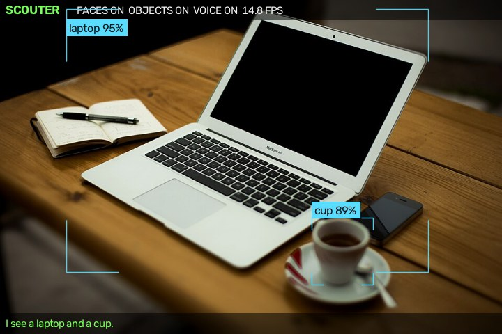

# Scouter 2

A camera that tells you who and what it sees, out loud.

Point a webcam (or a Raspberry Pi camera) at the room: Scouter recognises the people you've taught it, spots 80 kinds of everyday objects, and says what's there: *"Hello Alex."*, *"I see a laptop and two cups."*

<p align="center"></p>

This is a rewrite of an earlier (2020) Raspberry Pi project, Scouter, which never got as far as actually speaking what it saw.

## Features

- **Face recognition** with [YuNet](https://github.com/opencv/opencv_zoo/tree/main/models/face_detection_yunet) (detection) and [SFace](https://github.com/opencv/opencv_zoo/tree/main/models/face_recognition_sface) (recognition). Teach it a person in a few seconds from the webcam, or from a folder of photos.
- **Object detection** with [YOLOX](https://github.com/opencv/opencv_zoo/tree/main/models/object_detection_yolox): people, cups, phones, laptops, chairs, dogs… all 80 COCO classes.
- **Speech that doesn't nag**:
  - a known person is greeted when they show up, then not again for 30 seconds
  - an unknown face has to stay in view for 1.5 seconds before it's mentioned
  - an object has to be seen twice in a row before it's named, then not again for a minute
  - press **Space** any time to hear everything in view
- **Questions**: *"Scouter, where is my phone?"*, *"Scouter, who did you see today?"*. It remembers when it last saw every object and person, where in the view, and what was next to it. Ask out loud (offline, with [Vosk](https://alphacephei.com/vosk/)), type in the terminal, use the dashboard, or run `python -m scouter ask ...`
- **Event log with snapshots**: arrivals and departures of known people and unknown faces, and new objects, each with the time and a JPEG. It's kept in a local SQLite file with size and age limits. Search it with `python -m scouter log`
- **Alerts** when someone it doesn't know stays in view: a desktop notification, and optionally a Telegram message or a webhook, with a cooldown and quiet hours
- **Web dashboard** (`--web`): live annotated video, the event log, questions, and people management (enrol from the camera, rename, forget). Handy on a Pi without a screen
- **Scouter-style overlay** with corner brackets, names, confidence and a status bar
- Runs on **Windows, macOS, Linux and Raspberry Pi**, with a webcam, a phone camera stream (`http://…/video`), or the Pi camera module, with or without a screen
- Fully offline once the models are downloaded. Faces, the event log and snapshots stay on your machine, in `data/`. Nothing is sent anywhere unless you set up Telegram or a webhook alert

## Install

Needs Python 3.10 or newer.

```bash
git clone <this repository URL>
cd scouter-2
python -m venv .venv
.venv/Scripts/activate        # Windows; on macOS/Linux: source .venv/bin/activate
pip install -r requirements.txt
```

The three models (about 75 MB) download automatically on first run from the [OpenCV model zoo](https://github.com/opencv/opencv_zoo) and are checked against their SHA-256. To fetch them ahead of time: `python -m scouter download`.

## Use

```bash
python -m scouter enroll Alex          # look at the webcam for a few seconds
python -m scouter enroll Sam --photos path/to/sam_photos
python -m scouter                      # start
python -m scouter people               # who it knows
python -m scouter forget Sam
python -m scouter log --since today     # what happened today
python -m scouter ask where is my phone
```

While it runs: **Space** say what you see · **m** mute · **f** faces on/off · **o** objects on/off · **q** quit

Useful options for `python -m scouter`:

| Option | |
|---|---|
| `--camera 1` | another webcam |
| `--camera http://192.168.0.50:8080/video` | a phone running an IP-camera app |
| `--camera picamera` | the Raspberry Pi camera module |
| `--headless` | no window, for a Pi without a screen (Ctrl+C to stop) |
| `--quiet` | print what it would say instead of speaking |
| `--no-objects` / `--no-faces` | only faces / only objects |
| `--threshold 0.45` | stricter face matching (default 0.363) |
| `--cooldown 60` | seconds before repeating a person (objects wait twice as long) |
| `--listen` | answer spoken questions (see below) |
| `--web` | serve the dashboard on http://localhost:8080 |
| `--alert-after 10` | alert when an unknown face stays 10 seconds |
| `--no-log` | no event log, snapshots or memory of where things were |

`python -m scouter run --help` lists everything.

## Asking questions

Start a question with **"Scouter"**: *"Scouter, where is my phone?"*, *"Scouter, where's the remote?"*, *"Scouter, when did you last see Sam?"*, *"Scouter, who did you see today?"*, *"Scouter, what do you see?"*. If you say just "Scouter", it answers "Yes?" and waits a few seconds for the question.

> *"I last saw your phone 12 minutes ago, at the bottom left of the view, next to the laptop."*

Speech recognition is optional and runs offline:

```bash
pip install vosk sounddevice
```

Then download a small English model from [alphacephei.com/vosk/models](https://alphacephei.com/vosk/models) (`vosk-model-small-en-us-0.15`, about 40 MB) and unzip it into `models/`. Start with `python -m scouter --listen`, or point `--vosk-model` at another folder. The microphone is ignored while Scouter is speaking.

Without a microphone you can:

- type the question in the terminal Scouter runs in and press Enter
- use the box on the dashboard
- ask from another terminal, even while Scouter isn't running:

```bash
python -m scouter ask who did you see today
```

It only knows the 80 COCO classes that YOLOX can see, such as phones, cups, bags, laptops, remotes and books. If you ask for your keys or wallet, it says it can't recognise those yet. Everyday words work too: phone, mug, sofa, TV, bag, fridge.

## Event log

While it runs, Scouter writes to `data/scouter.db`:

- a known person **arrived**, and **left** after 15 seconds out of view (`--leave-after`)
- an **unknown face** arrived (after 1.5 seconds in view) and left
- a new **object appeared**
- **alerts**

Each arrival keeps a JPEG snapshot with the overlay, in `data/snapshots/DATE/`. Events older than 30 days are deleted (`--keep-days`). When snapshots take more than 500 MB (`--keep-mb`), the oldest ones are deleted.

```bash
python -m scouter log                       # the last 50 events
python -m scouter log Alex --since 7d
python -m scouter log --type unknown --since yesterday --snapshots
python -m scouter log alert --since 2026-10-01 --until 2026-10-08
```

`--since` and `--until` take `30m`, `2h`, `7d`, `today`, `yesterday` or a date. The same file also remembers where every object and person was last seen, so questions still work after a restart. `python -m scouter forget NAME` also deletes where that person was last seen.

## Alerts

```bash
python -m scouter --alert-after 10 --alert-cooldown 600 --quiet-hours 08:00-18:00
```

When an unknown face stays in view for 10 seconds, Scouter:

- shows a desktop notification (Windows, macOS, or Linux with `notify-send`; `pip install plyer` gives a nicer one)
- logs an alert with a snapshot
- then stays silent for the cooldown (default 5 minutes)

No alerts are sent during quiet hours, but the visit is still logged. The range can wrap past midnight, e.g. `23:00-07:00`.

These options send the alert and its snapshot **off this machine**, so only use them if you want that:

| Option | Environment variable | |
|---|---|---|
| `--telegram-token`, `--telegram-chat` | `SCOUTER_TELEGRAM_TOKEN`, `SCOUTER_TELEGRAM_CHAT` | a photo message from your Telegram bot ([how to make one](https://core.telegram.org/bots/tutorial)) |
| `--webhook URL` | `SCOUTER_WEBHOOK` | a JSON POST: `message`, `time`, `iso_time`, `snapshot_jpeg_base64` |

The environment variables keep the token out of your shell history. `--no-desktop-alert` turns the notification off.

## Web dashboard

```bash
python -m scouter --web                 # http://localhost:8080, this computer only
python -m scouter --headless --web --web-lan --web-password "choose-one"
```

The page shows:

- the live video with the overlay, and what Scouter last said
- a box for questions
- the event log with snapshots, searchable and filterable by type and time
- the people it knows

From there you can rename or forget people, or enrol someone new: type a name, then have them look at the camera until the 15 samples are collected.

By default, only this computer can open the dashboard. `--web-lan` opens it to your network and requires a password (HTTP Basic: any user name, plus that password). The connection isn't encrypted, so only use it on a network you trust, and never forward the port to the internet. Video is only encoded while a browser is watching.

## Raspberry Pi

Use Raspberry Pi OS 64-bit (Bookworm or newer), ideally on a Pi 4 or 5.

```bash
sudo apt install espeak-ng python3-picamera2   # speech, and the camera module if you use one
python -m venv --system-site-packages .venv    # so the venv can see picamera2
source .venv/bin/activate
pip install -r requirements.txt
python -m scouter --camera picamera --headless
```

Face recognition is quick on a Pi. Object detection runs on a background thread, so the video and face greetings stay responsive even when objects take a second or two to update. The Pi camera path is written for picamera2 but hasn't been tested on real hardware yet.

## How it works

```
camera thread ──> newest frame ──> faces: YuNet detect → SFace embed → match against data/faces.npz
                                │                                            │
                                └─> object thread: YOLOX (640×640)            ├─> Announcer → Voice thread (pyttsx3 / espeak)
                                                   │                          │
                                                   └──────────────────────────┼─> HUD overlay ──> window / MJPEG dashboard
                                                                              │
                                                                              ├─> Memory (last seen where) <── questions: Vosk / typed / web
                                                                              ├─> Presence → EventLog (SQLite + snapshots)
                                                                              └─> AlertRule → Notifier (desktop / Telegram / webhook)
```

| File | |
|---|---|
| `scouter/__main__.py` | command line, enrolment, `log` and `ask` |
| `scouter/app.py` | the main loop that ties everything together |
| `scouter/memory.py` | where and when each object and person was last seen |
| `scouter/ask.py` | answering questions |
| `scouter/listen.py` | wake word and Vosk speech recognition |
| `scouter/events.py` | arrivals and departures, the SQLite event log, snapshots and retention |
| `scouter/alerts.py` | the unknown-person rule, desktop / Telegram / webhook notifications |
| `scouter/web.py` | the dashboard and MJPEG stream |
| `scouter/faces.py` | face detection, embeddings, the face database |
| `scouter/objects.py` | YOLOX pre- and post-processing |
| `scouter/voice.py` | `Announcer` (what's worth saying) and `Voice` (speaking on a background thread) |
| `scouter/camera.py` | webcam / stream / Pi camera, always serving the newest frame |
| `scouter/hud.py` | the overlay |
| `scouter/models.py` | model download and checksum |

Two faces are the same person when the cosine similarity of their SFace embeddings is at least 0.363, the threshold the SFace authors give for their benchmark. Each person keeps all their enrolment samples, and a face is matched against the closest one.

## Tests

```bash
pip install pytest
python -m pytest
```

The tests cover:

- the announcement rules (cooldowns, debouncing, phrasing)
- the face database and YOLOX box decoding
- questions and answers, and the wake word
- arrivals and departures, the event log and its retention
- alert timing, quiet hours and the webhook
- the dashboard, including its password and cross-site protections

They need no camera, microphone or models.

## Credits

Models from the [OpenCV model zoo](https://github.com/opencv/opencv_zoo): YuNet (MIT), SFace (Apache 2.0), YOLOX (Apache 2.0). They are downloaded at run time, not included in this repository.

The screenshot uses [Home-office-336377.jpg](https://commons.wikimedia.org/wiki/File:Home-office-336377.jpg) from Wikimedia Commons (CC0).

## License

[MIT](LICENSE)
